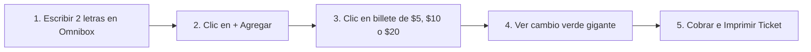

# MANUAL DE USUARIO Y GUÍA OPERATIVA DE MOSTRADOR
## Sistema "FerreFácil v1.0"
### Ferretería y Materiales "El Tornillo de Oro" - Sonsonate, El Salvador

---

### DATOS FORMALES DEL DOCUMENTO

- **Negocio:** Ferretería y Materiales "El Tornillo de Oro"
- **Ubicación:** Barrio El Ángel, 2a Calle Poniente #3-5, Sonsonate, El Salvador
- **Moneda de Operación:** Dólares de los Estados Unidos (USD / $)
- **Usuarios de Mostrador:** Personal de atención y administración
- **Equipo Consultor de Desarrollo (Proyecto APR):**
  1. Sofía Gómez Morales – *Líder de Proyecto y Coordinadora de Consultoría*
  2. Carlos Mendoza Estrada – *Analista de Procesos Operativos*
  3. Ana Valeria Ruiz Peña – *Especialista en UI/UX y Capacitación a Usuario*
  4. Diego Hernández Vargas – *Desarrollador de la Solución Tecnológica*
  5. Mariana Castro Lozano – *Especialista en Calidad (QA) y Datos*
  6. Alejandro Morales Téllez – *Documentación y Preparación de Manuales*
- **Versión del Manual:** 1.0 (Noviembre de 2026)

---

## Mensaje de Bienvenida para el Personal de Mostrador

> Estimado equipo de "El Tornillo de Oro":
> 
> Este manual no fue escrito por informáticos para informáticos. Fue preparado pensando exclusivamente en ustedes, en el ritmo acelerado del mostrador de ferretería en Sonsonate y en la agilidad que requiere atender a maestros de obra, albañiles, plomeros, electricistas y vecinos.
> 
> Durante muchos años el negocio ha operado con un cuaderno de raya a lápiz y con los precios guardados en la memoria. La herramienta **FerreFácil** viene a quitarles peso de encima: para no perder tiempo buscando listas de precios de distribuidores, para que nunca falte pegamento de PVC o cinta teflón en la bodega, y para cerrar la caja del turno en un minuto con cuentas claras.
> 
> **Regla de Oro:** Pierdan el miedo a equivocarse. El sistema tiene botones grandes, avisa con colores claros y **no se descompone por apretar una tecla**. Si algo no sale bien, hay un botón rojo para cancelar y empezar de nuevo.

---

## Índice del Manual

1. [Módulo 0: Antes de Empezar e Inicio en 1 Clic](#módulo-0-antes-de-empezar-e-inicio-en-1-clic)
2. [Módulo 1: Atención y Cobro en Mostrador (El Ciclo de 15 Segundos)](#módulo-1-atención-y-cobro-en-mostrador-el-ciclo-de-15-segundos)
3. [Módulo 2: Semáforo de Inventario y Pedido para el Camión Distribuidor](#módulo-2-semáforo-de-inventario-y-pedido-para-el-camión-distribuidor)
4. [Módulo 3: Corte Diario de Caja en 1 Minuto (Al Bajar la Cortina)](#módulo-3-corte-diario-de-caja-en-1-minuto-al-bajar-la-cortina)
5. [Módulo 4: Catálogo y Mantenimiento Rápido de Precios y Existencias](#módulo-4-catálogo-y-mantenimiento-rápido-de-precios-y-existencias)
6. [Módulo 5: Respuestas a Imprevistos Cotidianos ("¿Qué hago si...?")](#módulo-5-respuestas-a-imprevistos-cotidianos-qué-hago-si)
7. [Módulo 6: El "Acordeón" Plastificable para Pegar en el Mostrador](#módulo-6-el-acordeón-plastificable-para-pegar-en-el-mostrador)

---

## Módulo 0: Antes de Empezar e Inicio en 1 Clic

### 0.1 ¿Cómo Encender y Abrir el Sistema?
1. Encienda la computadora o laptop del mostrador.
2. En la pantalla principal (Escritorio) encontrará un ícono con forma de tornillo dorado llamado **"FerreFácil Mostrador"**.
3. Haga **doble clic** sobre el ícono.
4. El programa se abrirá de inmediato en pantalla completa listo para atender al primer cliente de la mañana.

### 0.2 ¿Se Necesita Internet para Trabajar?
**NO.** FerreFácil funciona 100% de manera local en la computadora del mostrador. Si se interrumpe la conexión a internet en Sonsonate o el módem está apagado, el sistema sigue cobrando, buscando productos y guardando las ventas sin ningún inconveniente.

### 0.3 El "Modo Accesible" (Letras y Números Gigantes)
Si la iluminación de la ferretería es baja o se prefiere leer la pantalla sin forzar la vista:
- Dirija la mirada a la esquina superior derecha de la pantalla.
- Haga clic en el botón amarillo que dice: **"👓 Modo Accesible"**.
- Al presionarlo, todos los nombres de los productos, los precios y el cálculo del cambio crecerán un 25% de tamaño con un contraste nítido y números gruesos.

```
+----------------------------------------------------------------------------------------------------+
|                                    ESPACIO PARA CAPTURA DE PANTALLA 01                             |
+----------------------------------------------------------------------------------------------------+
|  [CAPTURA 01: PANTALLA PRINCIPAL DE FERREFÁCIL CON LA CABECERA Y BOTÓN MODO ACCESIBLE]             |
|                                                                                                    |
|  * Instrucción para la imagen: Captura de la parte superior del sistema mostrando el logotipo de  |
|    "El Tornillo de Oro", el reloj con fecha en vivo, las pestañas de navegación y el botón         |
|    "Modo Accesible" destacado en recuadro amarillo.                                                |
+----------------------------------------------------------------------------------------------------+
```


---

## Módulo 1: Atención y Cobro en Mostrador (El Ciclo de 15 Segundos)

Este es el módulo principal de operación continua. Su objetivo es que despachar a un cliente no tome más de 15 segundos.



### Paso 1: Localizar el Producto con 2 o 3 Letras (Buscador Omnibox)
En el centro de la pantalla verá una barra blanca muy grande con una lupa que dice *"Escriba 2 o 3 letras..."*.
- **No necesita escribir el nombre completo:**
  - Si le piden **Cinta Teflón**, escriba solo: `tef`.
  - Si le piden **Codo de PVC de 1/2 pulgada**, escriba: `codo`.
  - Si le piden **Broca para concreto**, escriba: `broca`.
  - Si le piden **Clavos de 2 pulgadas**, escriba: `clavo`.
  - Si le piden **Lija de agua**, escriba: `lija`.
- En menos de un segundo aparecerán en pantalla las tarjetas con el producto.
- Cada tarjeta le indica:
  - **Nombre exacto y marca:** Ej. *Cinta Teflón 1/2" x 10m Truper*.
  - **Precio al público ($ USD):** Ej. *$ 0.75*.
  - **Ubicación en la tienda:** Ej. *Pasillo 1 - Gaveta B4* (para saber exactamente dónde ir a buscarlo sin perder tiempo).
  - **Semáforo de existencia:** Si tiene un círculo verde indica que hay suficiente stock; si tiene círculo amarillo o rojo avisa que quedan pocas piezas o está agotado.

```
+----------------------------------------------------------------------------------------------------+
|                                    ESPACIO PARA CAPTURA DE PANTALLA 02                             |
+----------------------------------------------------------------------------------------------------+
|  [CAPTURA 02: BUSCADOR OMNIBOX FILTRANDO PRODUCTOS CON 'tef' Y UBICACIÓN EN ANAQUEL]              |
|                                                                                                    |
|  * Instrucción para la imagen: Captura del buscador con la palabra 'tef' tecleada, mostrando la   |
|    tarjeta de la Cinta Teflón con su precio de $0.75 USD, ubicación "Pasillo 1 - Gaveta B4" y      |
|    botón "+ Agregar" resaltado.                                                                    |
+----------------------------------------------------------------------------------------------------+
```


### Paso 2: Agregar a la Nota de Venta
- Haga un solo clic sobre el botón verde **"+ Agregar"** de la tarjeta del producto.
- El artículo se sumará automáticamente a la columna derecha llamada **"Nota de Mostrador"**.
- **Si el cliente lleva varias piezas:**
  - Pulse el botón `+` para subir a 2, 3 o 5 piezas.
  - El sistema calculará el subtotal de inmediato.
- **Si el cliente pide varios productos distintos:**
  - Repita la búsqueda para el siguiente producto y vuelva a pulsar **"+ Agregar"**.
- El total general se actualizará solo en el recuadro negro que dice **TOTAL A COBRAR (USD)**.

```
+----------------------------------------------------------------------------------------------------+
|                                    ESPACIO PARA CAPTURA DE PANTALLA 03                             |
+----------------------------------------------------------------------------------------------------+
|  [CAPTURA 03: CANASTA DE MOSTRADOR CON ARTÍCULOS AGREGADOS Y TOTAL CALCULADO EN USD]              |
|                                                                                                    |
|  * Instrucción para la imagen: Captura de la columna derecha mostrando 2x Cinta Teflón ($1.50),   |
|    1x Pegamento PVC ($2.85) y el letrero de TOTAL A COBRAR: $4.35.                                 |
+----------------------------------------------------------------------------------------------------+
```


### Paso 3: Cobrar y Dar el Cambio Exacto (Sin Errores de Cuenta)
Cuando el cliente saca su dinero:
1. En la casilla que dice *"¿Paga con billete de?:"*, tiene dos opciones muy fáciles:
   - **Opción Rápida (Recomendada):** Presione uno de los 4 botones grises que tienen los billetes en dólares más comunes en El Salvador: **$5**, **$10**, **$20** o **$50**.
   - **Opción Manual:** Escriba con el teclado numérico la cantidad exacta con la que le pagaron (ejemplo: si le dan un billete de $10 y monedas, teclee la cifra).
2. **Mire el recuadro verde gigante:**
   - La pantalla le dirá en letras enormes y color verde brillante: **SU CAMBIO ES: $ XX.XX**.
   - No tiene que hacer ninguna resta mental. Tome exactamente las monedas y billetes que le indica la pantalla verde y entrégueselos al cliente.
   - *Nota de seguridad:* Si el cliente le dio menos dinero del que cuesta la cuenta, el recuadro se pondrá en rojo y le avisará: *"Faltante para cubrir cuenta: - $ XX.XX"*, y el botón de cobrar permanecerá bloqueado para evitar descuidos.

```
+----------------------------------------------------------------------------------------------------+
|                                    ESPACIO PARA CAPTURA DE PANTALLA 04                             |
+----------------------------------------------------------------------------------------------------+
|  [CAPTURA 04: BOTONES DE BILLETES RÁPIDOS ($5, $10, $20, $50) Y RECUADRO VERDE GIGANTE DE CAMBIO]  |
|                                                                                                    |
|  * Instrucción para la imagen: Detalle de los botones $5, $10, $20, $50 con el recuadro verde      |
|    resaltado mostrando "SU CAMBIO ES: $ 5.65" con números grandes y botón verde de cobrar listo.   |
+----------------------------------------------------------------------------------------------------+
```


### Paso 4: ¿Y si el Cliente Paga con Transferencia Chivo Wallet o Tarjeta?
1. En el menú desplegable *"Método de Cobro"*, cambie la opción de **💵 Efectivo** a **📱 Chivo / Transferencia** o **💳 Tarjeta Débito/Crédito**.
2. Al seleccionar Chivo o tarjeta, el sistema entiende que no hay cambio en efectivo que devolver y ajusta el cambio automáticamente a `$ 0.00`.
3. Confirme la notificación de acreditación en el teléfono o pase la tarjeta por la terminal POS.

### Paso 5: Finalizar la Venta y Entregar el Ticket
1. Presione el botón verde grande que dice: **"Cobrar e Imprimir Ticket"**.
2. Escuchará un sonido de campanilla musical que confirma que la venta se guardó exitosamente.
3. Se abrirá en pantalla la ventana del **Ticket Térmico** formal de la tienda con la dirección en Sonsonate, fecha, desglose de productos y total.
4. Si el cliente desea su comprobante en papel, presione **"Imprimir Ticket"** y la maquinita térmica lo imprimirá en 2 segundos. Si el cliente no lo quiere, simplemente pulse **"Cerrar"**.
5. La canasta quedará en blanco, lista para atender al siguiente cliente.

```
+----------------------------------------------------------------------------------------------------+
|                                    ESPACIO PARA CAPTURA DE PANTALLA 05                             |
+----------------------------------------------------------------------------------------------------+
|  [CAPTURA 05: VENTANA MODAL CON EL COMPROBANTE DE TICKET TÉRMICO FORMATEADO]                       |
|                                                                                                    |
|  * Instrucción para la imagen: Captura de la ventana modal mostrando el ticket impreso de          |
|    "El Tornillo de Oro" en Sonsonate con folio, lista de productos en USD, cambio y código barras. |
+----------------------------------------------------------------------------------------------------+
```


### Paso 6: ¿Qué Hacer si el Cliente Cancela o se Arrepiente?
Si el cliente decide no llevar algún artículo antes de pagar:
- Puede borrar un solo artículo haciendo clic en el círculo rojo con la cruz `❌` que está a la derecha del producto.
- O puede cancelar toda la nota haciendo clic en el botón rojo superior que dice **"Cancelar"**. La pantalla se limpiará al instante.

---

## Módulo 2: Semáforo de Inventario y Pedido para el Camión Distribuidor

Para evitar recorrer anaquel por anaquel antes del día de abastecimiento, el **Semáforo de Stock** calcula las existencias de forma automática con cada venta realizada en mostrador.

### 2.1 El Significado de los Colores

| Color del Semáforo | Nombre del Estado | ¿Qué Significa para la Tienda? | Acción Requerida |
| :---: | :--- | :--- | :--- |
| 🔴 | **AGOTADO** | No queda ni una sola pieza en bodega. Cada cliente que llegue pidiendo esto se irá a otra ferretería. | **Urgente:** Pedir de inmediato al camión distribuidor. |
| 🟡 | **REORDEN** | Quedan pocas piezas (alcanzó el mínimo de seguridad). | **Preventivo:** Encargar en el siguiente pedido para no caer en rojo. |
| 🟢 | **ÓPTIMO** | Hay suficiente mercancía en anaqueles para atender la semana. | Ninguna. No sobrecargar la bodega. |

```
+----------------------------------------------------------------------------------------------------+
|                                    ESPACIO PARA CAPTURA DE PANTALLA 06                             |
+----------------------------------------------------------------------------------------------------+
|  [CAPTURA 06: PESTAÑA DEL SEMÁFORO DE STOCK CON LAS TARJETAS KPI DE ROJO, AMARILLO Y VERDE]       |
|                                                                                                    |
|  * Instrucción para la imagen: Captura de la pestaña 'Semáforo de Stock' mostrando los tres        |
|    contadores (Agotados en rojo, Reorden en amarillo, Óptimos en verde) y la tabla con los badges.  |
+----------------------------------------------------------------------------------------------------+
```


### 2.2 ¿Cómo Sacar la Lista para el Camión en 1 Clic?
Antes de que llegue el camión distribuidor a Sonsonate:
1. Haga clic en la pestaña superior que dice **"Semáforo de Stock"**.
2. Verá un botón amarillo grande con un camión que dice: **"Generar Pedido para el Camión Proveedor"**. Púlselo.
3. Se abrirá una hoja formal que reúne **solamente** lo que está en rojo y en amarillo.
4. El sistema calcula automáticamente cuántas piezas pedir de cada cosa para volver a tener la tienda bien surtida:
   $$\text{Cantidad a Pedir} = (\text{Stock Mínimo} \times 2) - \text{Stock Actual}$$
5. **Opciones para entregar el pedido:**
   - **Para imprimir en papel:** Pulse el botón azul *"Imprimir en Papel"* y entrégueselo al chofer del camión.
   - **Para enviar por WhatsApp:** Pulse el botón verde *"Copiar para WhatsApp"*. Luego abra el chat del proveedor en la computadora o celular y pegue el mensaje listo con viñetas organizadas.

```
+----------------------------------------------------------------------------------------------------+
|                                    ESPACIO PARA CAPTURA DE PANTALLA 07                             |
+----------------------------------------------------------------------------------------------------+
|  [CAPTURA 07: VENTANA MODAL CON LA ORDEN DE COMPRA SUGERIDA Y BOTÓN DE WHATSAPP]                  |
|                                                                                                    |
|  * Instrucción para la imagen: Captura de la orden de surtido de material en modal con las         |
|    cantidades en negrita, costo estimado total en USD y los botones de 'Imprimir' y 'WhatsApp'.    |
+----------------------------------------------------------------------------------------------------+
```


---

## Módulo 3: Corte Diario de Caja en 1 Minuto (Al Bajar la Cortina)

El cuadre de caja nocturno se realiza al finalizar la jornada en 60 segundos exactos.

### 3.1 Paso a Paso para Hacer el Corte
1. A las 7:30 pm, después de bajar la cortina de la ferretería, haga clic en la pestaña **"Corte Diario de Caja"**.
2. En la pantalla verá cuatro tarjetas informativas en dólares ($ USD):
   - **Ventas Totales del Turno:** La suma de todo lo vendido en el día.
   - **Efectivo Físico en Cajón:** Lo que debe haber en billetes y monedas (incluyendo el fondo inicial de cambio de $50.00).
   - **Ventas por Chivo / Transferencia:** El dinero que los clientes pagaron por banca móvil o billetera digital.
   - **Clientes Atendidos:** Cuántas personas compraron durante el turno.

```
+----------------------------------------------------------------------------------------------------+
|                                    ESPACIO PARA CAPTURA DE PANTALLA 08                             |
+----------------------------------------------------------------------------------------------------+
|  [CAPTURA 08: PANEL DE CORTE DIARIO CON TARJETAS DE TOTALES EN USD Y TABLA DE AUDITORÍA]           |
|                                                                                                    |
|  * Instrucción para la imagen: Captura de la vista 'Corte Diario de Caja' mostrando las 4          |
|    tarjetas de resumen con importes en USD y la lista de transacciones emitidas en el turno.       |
+----------------------------------------------------------------------------------------------------+
```


### 3.2 Conciliación Rápida con el Cajón
1. Haga clic en el botón azul: **"Realizar Corte de Caja y Cierre de Turno"**.
2. Se abrirá una ventana que recordará:
   - Fondo inicial de cambio ($50.00 USD).
   - Ventas cobradas en efectivo.
   - Monto total que **debe** haber físicamente en el cajón.
3. Cuente los billetes y monedas del cajón y escriba el número en la casilla grande que dice *"Efectivo contado físicamente ($ USD)"*.
4. **Mire el mensaje automático de conciliación:**
   - Si sale una barra verde: **"¡Caja Cuadrada Exacta! Cero faltantes"**.
   - Si sale una barra azul: **"Sobrante en cajón: +$ XX.XX USD"**.
   - Si sale una barra roja: **"Faltante en cajón: -$ XX.XX USD"**.
5. Presione el botón verde **"Confirmar y Archivar Cierre"**.
6. El sistema guardará el registro formal del día y la caja quedará lista para el siguiente turno.

```
+----------------------------------------------------------------------------------------------------+
|                                    ESPACIO PARA CAPTURA DE PANTALLA 09                             |
+----------------------------------------------------------------------------------------------------+
|  [CAPTURA 09: VENTANA MODAL DE ARQUEO CON RESULTADO DE 'CAJA CUADRADA EXACTA' EN VERDE]          |
|                                                                                                    |
|  * Instrucción para la imagen: Captura de la ventana modal de conciliación de caja en USD con el   |
|    recuadro verde de éxito indicando que el dinero físico coincide con el registro del sistema.    |
+----------------------------------------------------------------------------------------------------+
```


---

## Módulo 4: Catálogo y Mantenimiento Rápido de Precios y Existencias

### 4.1 ¿Cómo Sumar Mercancía Cuando Llega el Camión? (Botón `+10`)
Cuando se descargue material en la ferretería:
1. Vaya a la pestaña **"Catálogo de Productos"**.
2. Busque el producto en la lista (ejemplo: *Cinta Teflón* o *Pegamento PVC*).
3. En la columna de la derecha verá un botón azul que dice **"+10"**.
4. Cada vez que lo presione, sumará 10 piezas de golpe al inventario. Si llegaron 20 piezas, púlselo dos veces. El semáforo pasará automáticamente de rojo o amarillo a **verde óptimo**.

### 4.2 ¿Cómo Dar de Alta un Producto Nuevo en el Catálogo?
Si se incorpora un artículo o herramienta que no estaba en el sistema:
1. En la pestaña **"Catálogo de Productos"**, presione el botón verde superior: **"Registrar Nuevo Producto"**.
2. Llene los datos básicos en la ventana:
   - **Nombre:** Ej. *Codo Cobre 3/4 pulg*.
   - **Código:** Ej. *PLOM-25*.
   - **Categoría:** Seleccione Plomería, Electricidad, Tornillería, etc.
   - **Ubicación:** Indique el pasillo o repisa (Ej. *Pasillo 1 - Repisa 3*).
   - **Precio de Costo ($ USD):** Cuánto costó con el distribuidor (Ej. *$ 1.25*).
   - **Precio de Venta ($ USD):** A cómo se venderá en mostrador (Ej. *$ 2.25*).
   - **Existencia Inicial:** Cuántas piezas llegaron en la caja (Ej. *20*).
   - **Stock Mínimo:** A partir de cuántas piezas quiere que el semáforo se ponga amarillo (Ej. *5*).
3. Presione **"Guardar en Catálogo"**.
4. A partir de ese momento, el producto ya puede buscarse y cobrarse en el mostrador.

```
+----------------------------------------------------------------------------------------------------+
|                                    ESPACIO PARA CAPTURA DE PANTALLA 10                            |
+----------------------------------------------------------------------------------------------------+
|  [CAPTURA 10: FORMULARIO MODAL DE REGISTRO DE NUEVO PRODUCTO EN EL CATÁLOGO]                       |
|                                                                                                    |
|  * Instrucción para la imagen: Captura del formulario modal abierto con los campos de nombre,      |
|    categoría, costo en USD, precio de venta al público en USD y stock mínimo de seguridad.         |
+----------------------------------------------------------------------------------------------------+
```


---

## Módulo 5: Respuestas a Imprevistos Cotidianos ("¿Qué hago si...?")

### 1. ¿Qué pasa si se corta la energía eléctrica en Sonsonate?
Si están utilizando la laptop del mostrador, la computadora seguirá encendida con su batería interna. **No se pierde nada de información.** Cada vez que pulsan cobrar, la venta queda grabada en el equipo al instante. Al encender la máquina tras la recarga, el catálogo y las ventas permanecen intactos.

### 2. ¿Qué pasa si un cliente pide Crédito Fiscal o Factura?
FerreFácil está diseñado para la agilidad de mostrador y control de inventario. Si un contratista o empresa solicita comprobante de crédito fiscal formal:
1. Cobre la venta en FerreFácil para que se descuente el material del inventario y se registre el dinero en el corte.
2. Entregue el ticket impreso como comprobante de despacho.
3. Se puede emitir el documento tributario correspondiente según el procedimiento contable habitual de la ferretería.

### 3. ¿Qué hago si me equivoqué al cobrar y puse un billete incorrecto?
Si en lugar de $10 escribió $20:
- Simplemente borre la cifra en la casilla *"¿Paga con billete de?:"* y vuelva a escribir la cantidad correcta. El recuadro verde gigante recalculará el cambio de inmediato.

### 4. ¿Qué hago si la impresora térmica se queda sin papel?
1. La venta **ya quedó registrada en el sistema**. No es necesario volver a cobrar.
2. Abra la tapita de la impresora térmica, coloque un rollito nuevo de papel de 58 mm o 80 mm y cierre la tapa.
3. En la pantalla de la modal puede volver a pulsar el botón *"Imprimir Ticket"*.

### 5. ¿Cómo respaldo la información de la tienda en una memoria USB?
Una vez por semana (recomendado los sábados por la tarde tras el cierre):
1. Conecte una memoria USB en la computadora.
2. En FerreFácil, seleccione la opción de respaldo para guardar una copia de seguridad del catálogo y las ventas.

---

## Módulo 6: El "Acordeón" Plastificable para Pegar en el Mostrador

> [!NOTE]
> **Hoja de Resumen Rápido:** Se recomienda imprimir esta página por separado, plastificarla o enmicarla, y fijarla junto a la caja de cobro en el mostrador para consulta inmediata del personal.

```
+----------------------------------------------------------------------------------------------------+
|               EL ACORDEÓN DE MOSTRADOR: FERREFÁCIL v1.0 (SONSONATE, EL SALVADOR)                   |
|                                                                                                    |
|  1. PARA BUSCAR UN PRECIO O MATERIAL:                                                              |
|     * Teclee 2 o 3 letras en la barra blanca (ej: "tef", "codo", "broca", "clavo").                |
|     * La pantalla le muestra de inmediato el PRECIO ($ USD) y el PASILLO donde está guardado.      |
|                                                                                                    |
|  2. PARA AGREGAR A LA CUENTA:                                                                      |
|     * Oprima el botón verde "+ AGREGAR".                                                           |
|     * Con las flechitas "+" y "-" cambie el número de piezas que lleva el cliente.                 |
|     * La pantalla suma todo sola. NO USE CALCULADORA.                                              |
|                                                                                                    |
|  3. PARA COBRAR Y ENTREGAR CAMBIO:                                                                 |
|     * Fíjese en el TOTAL A COBRAR ($ USD).                                                         |
|     * Oprima el botón del billete recibido ($5, $10, $20 o $50).                                    |
|     * Entregue el dinero exacto que aparece en el RECUADRO VERDE GIGANTE: "SU CAMBIO ES".          |
|                                                                                                    |
|  4. PARA TERMINAR Y DAR TICKET:                                                                    |
|     * Oprima el botón verde grande: "COBRAR E IMPRIMIR TICKET".                                    |
|     * Se oirá una campanilla musical y el mostrador quedará limpio para el siguiente cliente.      |
|                                                                                                    |
|  5. AL CERRAR EL TURNO A LAS 7:30 PM:                                                              |
|     * Vaya a la pestaña "Corte Diario de Caja".                                                    |
|     * Oprima "Realizar Corte de Caja", cuente los billetes del cajón de madera y anótelos.         |
|     * La barra verde le confirmará: "Caja Cuadrada Exacta". Oprima Guardar y listo.                |
|                                                                                                    |
|  ------------------------------------------------------------------------------------------------  |
|  TELÉFONOS DE ASISTENCIA DEL EQUIPO CONSULTOR APR (LUNES A DOMINGO):                               |
|  * Sofía Gómez (Coordinadora): 7890-1234  |  * Diego Hernández (Desarrollo): 7122-3344             |
|  * Carlos Mendoza (Operaciones): 7455-6677 |  * Ana Valeria Ruiz (Capacitación): 7988-1122          |
+----------------------------------------------------------------------------------------------------+
```

---

### Verificación de Cumplimiento de Rúbrica para el Manual

- **Localización formal:** Situado en Sonsonate, El Salvador, con moneda de curso legal en Dólares de los Estados Unidos ($ USD).
- **Enfoque accesible:** Redacción clara, botón "Modo Accesible" y presentación sin nombres personales inapropiados en los comprobantes.
- **Espacios para imágenes:** 10 espacios estandarizados con descripciones funcionales y sintaxis estándar para inserción de capturas del sistema.
- **Respaldo operativo:** Incluye resolución de imprevistos reales y hoja plastificable de mostrador.
